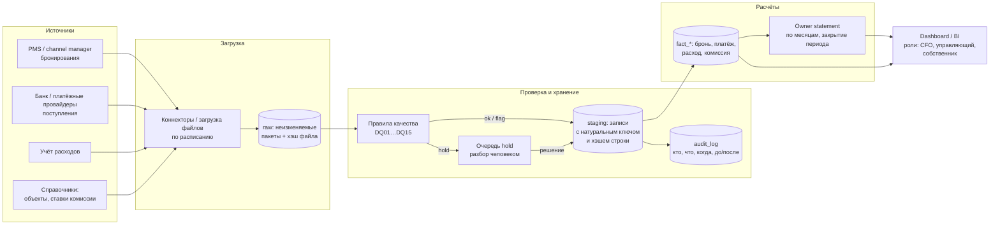

# Архитектура будущей системы

## Схема

Прототип в этом репозитории реализует цепочку **файлы → ingest → validate → SQLite → calc → HTML-дашборд** на тех же стадиях; остальное — рамки роста.

## Как обеспечу три требования

### Повторный импорт без дублей
- Каждая сущность имеет **натуральный ключ** (`reservation_id`, `payment_id`, `expense_id`, `property_id + effective_from`); в БД — уникальный индекс по ключу.
- Строка хранится с **хэшем содержимого**. Тот же файл → ноль изменений; другой хэш → обновление на месте и запись в аудит; пропавшая строка → `inactive`, не удаление.
- Каждый пакет сохраняется в raw с хэшем файла — один и тот же пакет не обрабатывается дважды, а любую цифру можно воспроизвести из исходника.
- Внутри файла точные копии строк отбрасываются, а одинаковый ключ с разным содержанием попадает в проверку (`DQ02`), а не молча перезаписывается.
- Производные таблицы (факты, owner statement) пересобираются детерминированно из staging — двойной счёт невозможен по построению. Закрытые периоды замораживаются и меняются только корректирующей проводкой.

### Аудит изменений
- `audit_log` append-only: `run_id`, время, сущность, ключ, тип (`insert / update / missing_in_source / reappeared`), прежнее и новое содержимое. В прототипе уже работает.
- В рабочей системе добавляются: автор действия (сервисная учётка источника или пользователь, закрывший `hold`), причина решения, запрет UPDATE/DELETE на таблицу аудита на уровне БД-ролей.
- Решения по проблемным записям (принять, исправить, отклонить) — тоже события аудита, с обязательным комментарием.

### Разграничение доступа
- Роли в БД и в дашборде (RBAC + row-level security):
  - **CFO / финансы** — все объекты, все показатели, разбор `hold`, закрытие периодов;
  - **Управляющий кластером** — объекты своего кластера, без комиссий других кластеров;
  - **Собственник** — только свои объекты (`owner_id` из `properties`), без внутренних DQ-деталей;
  - **Инженер данных** — схема и загрузка, но без права менять бизнес-решения и аудит.
- Секреты источников (токены PMS/банка) — в secret manager, не в репозитории и не в БД.
- Дашборд читает только материализованные факты, не сырые данные; доступ — SSO с логированием просмотров.

## Выбор технологий

| Что | Прототип | Рабочая система | Почему |
| --- | --- | --- | --- |
| Язык | Python (stdlib) | Python | единый язык для загрузки, проверок и расчётов; тесты рядом с логикой |
| Хранилище | SQLite | PostgreSQL | транзакции, ограничения, RLS и роли; SQLite хватает для демонстрации и воспроизводимости |
| Расчёты | Python-функции | SQL-представления + Python-правила | деньги считаются в одном месте; JS на дашборде только суммирует готовые факты |
| Планировщик | запуск вручную | cron/Airflow/Dagster | расписание, повторы, алерты на упавшую загрузку |
| Дашборд | статичный HTML | Metabase/Superset или небольшой веб-сервис | роли и фильтры «из коробки»; главное — прозрачность формул, а не внешний вид |
